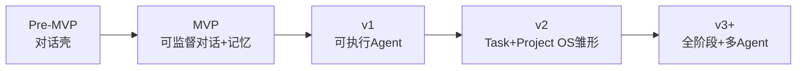

# Hal Agent 演进路线图

> 来源：  
> 1）行业调研（为何各大厂推 Agent Window、解决什么问题、痛点与趋势）  
> 2）CLI → Agent Window 演进分析  
> 3）企业 AI「Demo→生产」机制论（《为什么95%企业AI仍停留在Demo阶段》要点）  
> 4）产品愿景：全流程项目交付（阶段规划表 + Skills + Harness）  
>  
> 适用：本仓库自建 Hal Agent（React + FastAPI + LiteLLM）  
> 原则：**可监督轨迹 → 可靠工具 → 记忆压缩 → 多 Agent**；**组织与运行机制产品化**；不先堆无用 UI  
> 北极星：**有多少闭环真正进入日常工作流且可运营**（而非「聊得爽」）  
> 长期定位：**以阶段门禁 + Skill/Harness 驱动的项目交付工作台**（Project OS），Agent 在每阶段执行并留下可审计产物

---

## 0. 战略定位（调研结论）

| 维度 | 结论 |
|------|------|
| 本质 | Agent Window = **模型 + 工具 + 项目状态 + 人的监督台** |
| 行业意图 | 抢 AI 干活的默认入口；从「顾问」变成「可监督的执行者」 |
| 要解决的问题 | 上下文断裂、只会说不会做、单轮不够、工具碎片、行为不透明 |
| 下一阶段赢家标准 | 执行稳、权限清、记忆准、成本可控、轨迹可审计 |
| UI 演进方向 | Chat UI → **Task UI**（目标 / 步骤 / 产物 / 验收） |
| 历史位置 | Window 是 **CLI 时代 LLM 用法的可视化升级**，不是凭空新品类 |
| 企业分水岭 | 不在「有没有部署 AI」，而在能否建立 **统一管理、持续复用、连接真实业务并不断改进** 的运行方式 |
| 长期愿景 | **Project OS**：立项→…→结项全流程；时间+内容规划表；大项绑定 Skill+Harness；出口产物门禁 |

本路线图把上述结论拆成可交付阶段，并映射到本仓库现状。全流程愿景见 **§12**，落地仍嵌在 MVP→v1→v2 能力层之上，避免另起空架子。

---

## 0.1 从 CLI 到 Agent Window（历史脉络与启示）

### 判断

Agent Window **很大程度是从 CLI 时期进化来的**：CLI 把 LLM 嵌进工程师流水线；Window 把同一条路做成可监督的工作台。

### CLI 时期 LLM 如何被使用

| 形态 | 典型 | 用法 |
|------|------|------|
| 补全型 | 早期 Copilot 等 | 光标处续写，几乎无「对话」 |
| 对话型 CLI | `llm`、shell-gpt、各类 chat REPL | 管道/交互问答，文件当参数喂入 |
| 代理型 CLI | Aider、Claude Code CLI 等 | 仓库内循环：读文件 → 改 → 测 → git；终端确认 |

共性：Unix 组合子（stdin/stdout/管道）、显式上下文（`-f` / `@path` / git diff）、键盘与脚本优先、状态很薄（终端缓冲 + 本地文件）。

### CLI 时期解决什么问题

相对「浏览器 Chat 来回粘贴」：

1. 回到开发者主战场（终端/仓库）  
2. 可编程：可进 alias、Makefile、CI、SSH  
3. 上下文更可控：用文件/diff/命令输出精确投喂  
4. 开始「能干活」（代理型 CLI）  
5. 远程友好、无 GUI 也能用  

**一句话：** CLI 解决的是「把 LLM 嵌进已有工作流」，不是「做一个漂亮产品」。

### CLI 时期的痛点

| 痛点 | 表现 |
|------|------|
| 可见性差 | 多文件 diff、工具轨迹淹没在滚动日志里 |
| 监督 UX 弱 | y/n、整段 diff 刷屏；精细应用 hunk 很难 |
| 上下文仍易炸 | 全仓盲塞或靠人手工挑文件 |
| 会话/记忆弱 | 关终端即散，跨天任务难接续 |
| 非工程师不友好 | 难成大众默认入口 |
| 可观测与审计弱 | 企业难回答「改了什么、凭什么改」 |
| 组合强但产品弱 | 管道强，品牌/付费/权限体系弱 |

### Agent Window 解决了吗？

| CLI 痛点 | Window 是否解决 | 说明 |
|----------|-----------------|------|
| 可见性差 | **基本解决** | 消息流、侧栏、高亮；可再接 diff 面板 |
| 监督 UX 弱 | **改善中** | 确认/设置更自然；真正的 diff 审批多数仍在补 |
| 上下文爆炸 | **未真正解决** | UI 更好看，投喂策略往往仍粗 |
| 会话/记忆弱 | **部分解决** | 会话列表、收藏、持久化；深度记忆仍弱 |
| 非工程师门槛 | **明显改善** | 图形界面降低进入成本 |
| 审计/轨迹 | **部分改善** | 聊天可见；结构化工具轨迹常缺失 |
| 可编程/CI/SSH | **明显退步** | 易变成「只能点」，丢掉管道与无头模式 |

**新引入问题：** 假装已具备本机/云能力；重 UI、轻执行协议；与终端双轨不同步；成本与权限被界面藏住。

**结论：** Window 更好解决了「看见、点选、留存、面向更多人」；**没有自动解决**上下文、可靠执行、权限、成本；还削弱了 CLI 的可组合与无头能力。若丢掉 CLI 之魂只留聊天皮，是退化不是进化。

### 对路线图的直接启示

1. **保留 CLI 的魂**：同一 Agent Runtime；Window = 监督 UI，CLI/CI 调同一 API  
2. **窗口优先补 CLI 短板**：diff 审批、步骤时间线、任务状态、证据面板  
3. **继承显式投喂**：`@file`、选区、git diff、命令输出为一等公民  
4. **权限比 y/n 更细但不更糊**：读自动 / 写审批 / 外网审批；每步可回放  
5. **记忆超越终端缓冲**：分层记忆 + 写入确认 = Window 护城河  
6. **进化路径**：先做到 CLI 能做的（读改跑、可脚本），再用 UI 做 CLI 做不好的（审、留、协）  
7. **本仓库对齐**：MVP 做记忆/轨迹；v1 接代理型 CLI 的活但监督更好；全程预留无头 CLI（`agent ask` / `agent run`）；This PC 对齐「cwd + git root」心智

---

## 0.2 企业 AI：为何 95% 停在 Demo（机制论与落地）

> 核心观点（文章《为什么95%企业AI仍停留在Demo阶段》）：  
> **最大瓶颈不是技术能力不足，而是缺乏把 AI 从「演示品」变成「生产系统」的组织与管理机制。**

### 现状

- 「两头热、中间难」：高层推动、员工爱用，中间接入数据/流程/管理体系极难  
- 约仅 5% Agent 真正进入工作流，其余停在试点/PoC  

### 根本矛盾：厂商卖组件，企业要系统

| 矛盾 | 表现 |
|------|------|
| 能力边界不匹配 | 厂商按模型/数据/平台切产品；企业要的是跨部门业务流程闭环 |
| 交付模式不兼容 | 组件易演示、易采购；企业要长期稳定运行与持续维护 |
| 缺乏系统 Owner | 业务/IT/安全职责分散，无人对整体结果与长期运营负责 |

### Demo → 生产的四大鸿沟

1. 数据是否持续、准确且能稳定调用？  
2. 权限、审批、审计和回滚是否完善？  
3. 业务规则和上下文是否明确且一致？  
4. 上线后由谁负责更新、维护和迭代？  

### 六步走（文章方案 → 本项目产品化）

| 步骤 | 文章含义 | 本仓库落地 |
|------|----------|------------|
| **1. 盘点** | 摸清已在用的 AI 工具与资产 | 资产清单：LiteLLM 入口、会话、Skills、USER.md、工作区；健康状态入库 |
| **2. 选场景** | 高价值、跨环节、风险可控的闭环 | 先做窄闭环：记忆确认写入 / 或「读文件→diff 审批→应用」 |
| **3. 建系统** | Agent + 流程/权限/审批/审计 | 写操作确认门、`audit_events`、规则/提示版本化、回滚点 |
| **4. 纳资产** | 试点纳入统一资产与生命周期 | 收藏可晋升为 Skill/规则；强制 Owner + pilot/production 状态 |
| **5. 统底座** | 统一身份/权限/安全，业务可自治 | 统一走 LiteLLM；密钥与安全默认；工作区自治 |
| **6. 扩流程** | 用真实运行数据扩展 | 使用率/错误率/拒绝率/一次通过率；达阈值才升 production |

### 映射到本项目的产品含义

| 文章论点 | 对本项目意味着什么 |
|----------|-------------------|
| 卡在中间层 | 不能只做对话 UI，要接权限、审计、记忆确认、工具审批、任务闭环 |
| 卖组件 vs 要系统 | 模型是组件；交付物是会话+记忆+工具+审批+资产台账 |
| 缺 Owner | 每个 Agent/Skill/规则必须有负责人与生命周期 |
| 竞争在系统层 | 差异化在可管理、可复用、可审计，而非多几个模型名 |

### 「离开 Demo」的最小生产定义（验收）

同时满足才算生产化起步：

1. 有明确 **业务闭环**（不是开放闲聊）  
2. 有 **审批门**（写记忆/改文件不可静默）  
3. 有 **审计日志**（可回放谁在何时让 AI 做了什么）  
4. 有 **Owner + 状态**（pilot / production）  
5. 有 **运行指标**（使用/错误/拒绝）并用于是否扩展  
6. 模型与密钥走 **统一底座**（LiteLLM）

### 取舍

- **少做：** 装饰性按钮、只像 Cursor 但无闭环的 UI  
- **多做：** 一个闭环上的系统能力（确认、审计、资产、指标）  
- **叙事：** Agent Window = 把 AI 从 Demo 推进生产的 **运行与治理层**

---

## 1. 现状基线（已完成 ≈ Pre-MVP）

已具备「能聊、能管会话」的壳，尚不具备「能干活、可监督」，更不具备「可运营的生产机制」。

| 能力 | 状态 |
|------|------|
| 工作区 / 会话 CRUD、侧边栏可调宽 | ✅ |
| 流式对话（LiteLLM）、模型切换 | ✅ |
| 收藏、消息导航高亮、搜索 | ✅ |
| Settings（外观 / Agent 开关占位 / 快捷键 / 数据） | ✅ 部分为占位 |
| 用户气泡导航高亮 | ✅ |
| USER.md 记忆、写入确认 | ❌ |
| 工具调用（终端 / 文件 / MCP） | ❌ |
| 任务对象、执行轨迹、diff 审阅 | ❌ |
| 上下文压缩、成本预算 | ❌（设置项已有开关，未落地） |
| This PC / 云端执行区分 | ❌（仅 UI 占位） |
| 审计日志 / 资产 Owner / pilot·production | ❌ |
| 无头 CLI 与 Window 共用 Runtime | ❌ |

---

## 2. 阶段总览



| 阶段 | 主题 | 核心交付 | 对应调研痛点 |
|------|------|----------|--------------|
| **MVP** | 可信对话 + 治理雏形 | 记忆确认、轨迹 Meta、压缩、审计事件、诚实能力、资产盘点 | CLI 记忆弱；Demo 鸿沟：数据/规则/运维起步 |
| **v1** | 可执行 Agent | 工具/MCP、本机上下文、diff 审批、沙箱；CLI 同 API | CLI 监督弱→补齐；组件→系统中的「执行层」 |
| **v2** | Task 工作台 + 运营 + Project OS 雏形 | 任务卡片、验收、评测/使用率、审计导出、资产晋升；**项目/阶段/规划表 + Skill/Harness 门禁** | Chat→Task；六步纳资产/扩流程；全流程利器起步 |
| **v3+** | 编排与混合云 + 全阶段模板 | 多 Agent、本机+云、企业策略、无头/CI；多项目并行与完整阶段库 | 多窗口碎片、安全合规、统底座深化 |

---

## 3. MVP — 可信的对话 Agent（建议下一迭代）

**目标：** 仍然以对话为主，但做到「记得住、管得住、看得懂」，并具备 **离开纯 Demo 的治理雏形**。

### 3.1 必须做

| # | 能力 | 说明 | 验收标准 |
|---|------|------|----------|
| M1 | **分层记忆** | `USER.md` + 会话摘要；写入前弹确认（对齐 Settings「写入记忆前确认」） | 确认后落盘；拒绝则不写 |
| M2 | **上下文压缩** | 长会话自动摘要旧轮次；对齐 Settings「自动压缩」 | 超阈值后请求 token 可控且回答不丢关键约束 |
| M3 | **执行轨迹雏形** | 每轮展示：使用模型、耗时、token、是否压缩/注入记忆 | 消息旁可见 meta，可复制 |
| M4 | **权限分级（只读级）** | 默认：只读记忆/设置；写记忆必须确认 | 无静默写盘 |
| M5 | **去掉/诚实化假能力** | This PC、注入技能等：未实现则隐藏或标「即将推出」 | 无误导开关 |
| M6 | **审计事件雏形** | `audit_events`：memory.write / model.switch 等 | 可按会话查出操作记录 |
| M7 | **资产盘点** | 设置或侧栏展示：模型入口、会话数、记忆文件、健康状态 | 对应文章「盘点」 |

### 3.2 应该做

| # | 能力 | 说明 |
|---|------|------|
| M8 | 会话内全文检索增强 | 现有 Search 扩展到跨会话（后端索引） |
| M9 | 导出会话 Markdown/JSON | 已有设置导出雏形 → 导出真实消息 |
| M10 | 错误可恢复 | LLM 530/401 分类提示 + 重试按钮 |
| M11 | 选定首个闭环文案 | 产品内标明「当前生产化场景」= 记忆闭环（避免开放闲聊当目标） |

### 3.3 明确不做（MVP）

- 终端/任意文件写入、MCP、多 Agent、云端 Worker、自动提 PR

### 3.4 MVP 成功标准

- 连续 20 轮对话不崩、不无声失败  
- 记忆写入 100% 经用户确认  
- 用户能回答：「这轮用了什么模型、有没有动我的记忆」  
- 能导出最近审计事件；Settings 无「假生效」开关  

---

## 4. v1 — 可执行的 Coding Agent

**目标：** 从「顾问」变成「在本机项目里干活的执行者」，但每步可拦；**接过代理型 CLI 的执行力，用 Window 做好监督**。

### 4.1 必须做

| # | 能力 | 说明 | 对齐调研 |
|---|------|------|----------|
| V1-1 | **本机工作区绑定** | This PC 成真：绑定仓库路径、打开文件列表注入上下文 | CLI 的 cwd/git root 心智 |
| V1-2 | **工具调用协议** | 优先 MCP 或自研 tool schema：读文件、列目录、搜索 | 工具总线；企业「建系统」 |
| V1-3 | **写操作审批** | 改文件前出 diff；Apply / Reject / 局部应用 | 可监督、防乱改；四大鸿沟之权限 |
| V1-4 | **命令沙箱** | 终端命令白名单 + 工作目录限制 + 输出截断 | 安全 |
| V1-5 | **轨迹时间线** | 工具调用步骤条：thought → tool → result → diff | 可观测性；补 CLI 可见性 |
| V1-6 | **失败重试策略** | 工具失败可解释 + 一键重试该步 | 工具脆弱 |
| V1-7 | **Runtime API / 无头入口雏形** | 同一后端可被 CLI 调用（即便 UI 未完整） | 保留 CLI 可组合之魂 |

### 4.2 应该做

| # | 能力 |
|---|------|
| V1-8 | Skills / Rules（`/skills`、项目级 AGENTS.md）自动/手动注入 |
| V1-9 | 模型路由：规划用大模型，补全/检索用小模型（设置可见） |
| V1-10 | Token/费用预算与早停 |
| V1-11 | 资产 Owner 字段；试点 Agent 标记 `pilot` |

### 4.3 v1 成功标准

- 完成「读文件 → 改 1–3 个文件 → 用户批 diff → 可选跑测试」闭环  
- 无审批不落盘；密钥不进提示词明文  
- 任意一步可在时间线回放  
- 至少一种无头调用路径可用（脚本或 CLI）  

---

## 5. v2 — Task 化工作台 + Project OS 雏形（Chat 退居二线）

**目标：** 主对象从「消息」变成「任务 / 项目阶段」；用运行数据做 **纳资产 / 扩流程**；落地 §12 的最小切片（单项目三阶段）。

### 5.1 必须做

| # | 能力 | 说明 |
|---|------|------|
| V2-1 | **任务卡片** | 目标、步骤、状态机（queued/running/blocked/done）、产物列表 |
| V2-2 | **验收标准** | 用户可写「怎样算完成」；Agent 对照自检 |
| V2-3 | **产物面板** | 中间主区：diff / 预览 / 日志；聊天降为旁路 |
| V2-4 | **审计包导出** | 一次任务：输入摘要、工具调用、diff、测试结果打包 |
| V2-5 | **内建评测集** | 仓库内固定任务（修 bug / 改文案 / 跑测试）统计成功率 |
| V2-6 | **运营看板** | 使用率、错误率、用户拒绝率、一次通过率 |
| V2-7 | **资产晋升** | 收藏/高频流程 → Skill/规则；状态 pilot→production 需阈值 |
| V2-8 | **Project OS 雏形** | 单项目 + 三阶段模板（见 §12.6）；规划表可编辑；阶段出口产物门禁 L1/L2 |
| V2-9 | **阶段绑定 Skill/Harness** | 当前阶段自动注入对应 Skill；缺产物时黄灯/需确认才能进入下阶段 |

### 5.2 应该做

| # | 能力 |
|---|------|
| V2-10 | 任务级并行（同一窗口多任务泳道，仍单 Agent） |
| V2-11 | 企业向：策略模板、强制 Owner 复核周期 |
| V2-12 | 用本仓库真实小需求当狗粮项目，跑通立项→开发→验收 |

### 5.3 v2 成功标准

- 用户日常以「创建任务 / 推进项目阶段」而非「纯闲聊」完成工作  
- 能回答：「这类任务成功率多少、平均花多少 token」  
- 至少 1 个闭环资产达到 `production` 状态定义  
- 至少 1 个样板项目走完约定的最小阶段链，且每阶段有出口产物记录  

---

## 6. v3+ — 多 Agent 与混合执行（前瞻）

对齐调研「多 Agent 编排、本机+云、窗口变薄」与企业「统底座」；并扩展 **全阶段 Project OS**。

| # | 能力 | 说明 |
|---|------|------|
| V3-1 | 角色编排 | Planner / Coder / Reviewer / Tester 分泳道 |
| V3-2 | 冲突合并 | 多 Agent 改同一文件时的合并与人工裁定 |
| V3-3 | 混合运行时 | 敏感本机沙箱；重活云端 VM；窗口统一审批 |
| V3-4 | 跨端会话协议 | 桌面 / Web / CI 共用同一「任务对象」 |
| V3-5 | 策略引擎 | 组织级：禁止外网、禁止改路径、强制测试门禁 |
| V3-6 | CLI 一等公民 | `agent run --task` 与 Window 完全对等能力 |
| V3-7 | 全阶段模板库 | §12 全阶段可复用；多项目并行；Harness L3 硬阻断可配置 |
| V3-8 | 阶段级多 Agent | 调研/开发/验收可派不同角色 Agent，仍受规划表与门禁约束 |

---

## 7. 能力 × 阶段矩阵

| 能力域 | MVP | v1 | v2 | v3+ |
|--------|:---:|:--:|:--:|:---:|
| 流式对话 / 会话管理 | ● | ● | ● | ● |
| 记忆确认 / 压缩 | ● | ● | ● | ● |
| 轨迹 / Meta | ◐ | ● | ● | ● |
| 审计事件 / 资产盘点 | ◐ | ● | ● | ● |
| 本机上下文 This PC | ○ | ● | ● | ● |
| 工具 / MCP | ○ | ● | ● | ● |
| Diff 审批 / 沙箱 | ○ | ● | ● | ● |
| 无头 CLI / 同 Runtime | ○ | ◐ | ● | ● |
| Task 对象 / 验收 | ○ | ○ | ● | ● |
| 评测 / 成本 / 运营看板 | ○ | ◐ | ● | ● |
| 资产 Owner / pilot·production | ○ | ◐ | ● | ● |
| Project / 阶段 / 规划表 | ○ | ○ | ◐ | ● |
| Skill 按阶段绑定 | ○ | ◐ | ● | ● |
| Harness 阶段门禁 | ○ | ○ | ◐ | ● |
| 多 Agent 编排 | ○ | ○ | ○ | ● |
| 云端 Worker | ○ | ○ | ◐ | ● |

● 完备　◐ 雏形　○ 不做

---

## 8. 技术落点（相对本仓库）

| 阶段 | 前端重点 | 后端重点 |
|------|----------|----------|
| MVP | 记忆确认 UI、消息 Meta、诚实 Settings、简易审计/资产视图 | `USER.md` API、摘要压缩、`audit_events`、用量统计 |
| v1 | Diff Viewer、工具步骤时间线、工作区选择器 | Tool runtime、MCP client、沙箱、审批状态机、CLI/API 入口 |
| v2 | Task 看板、运营看板、**项目阶段条 + 规划表编辑** | Task/Project/Phase 表、验收 runner、Skill 加载器、Harness 门禁、资产状态机 |
| v3+ | 全阶段模板、多泳道编排 UI | Agent bus、云端队列、策略引擎、多项目 |

**协议建议：** v1 起工具层按 MCP 兼容设计，避免后期重写。  
**存储建议：** 继续 SQLite 元数据 + Markdown/文件产物；v2 为 Task / Asset / **Project·Phase·WorkItem** 建表；规划表变更写入审计。  
**模型层：** 维持 LiteLLM 统一入口；v1 增加按步骤路由；阶段切换时切换 Skill 上下文。  
**双入口：** Window 与 CLI 共用后端；禁止只存在于前端的「假能力」。  
**Skill 目录约定：** `skills/01-initiate/` … 与阶段 ID 绑定（见 §12）。

---

## 9. 风险与约束（调研痛点 → 工程纪律）

1. **不静默写盘**：一切写操作默认拒绝，显式批准后执行  
2. **不假装已实现**：Settings / This PC / Skills 未接通前不做成「假生效」  
3. **成本可见**：Agent 循环必须有预算与早停  
4. **安全默认**：密钥、`.env`、生产凭证永不进入提示词  
5. **先单 Agent 做稳**：多 Agent 放在 v3，避免过早复杂度  
6. **不丢 CLI 之魂**：可脚本、可无头、显式上下文投喂始终保留演进空间  
7. **机制产品化**：Owner、生命周期、审批、审计写进系统，不写在口头约定里  
8. **全流程防空心**：不做「只有甘特没有产物」的项目管理套壳；每阶段强制出口产物  
9. **愿景与节奏分离**：Project OS 是长期定位；交付仍先 MVP→v1 工具与审批，再 v2 阶段表  

---

## 10. 建议排期（弹性）

| 阶段 | 粗估 | 出口 |
|------|------|------|
| MVP | 2–4 周 | 记忆确认 + 压缩 + Meta + 审计雏形 + 诚实 Settings |
| v1 | 6–10 周 | 本机读改文件 + diff 审批闭环 + Runtime API 雏形 |
| v2 | 8–14 周 | Task UI + 运营/评测 + **Project OS 三阶段雏形** + 资产晋升 |
| v3+ | 持续 | 全阶段模板 / 多 Agent / 云混合 / CLI 一等公民 |

---

## 11. 一句话路线

> **先让对话可信且可治理（MVP）→ 再让 Agent 能在本机干活且可拦，并保留无头入口（v1）→ 再把窗口升级成可运营的任务工作台与 Project OS 雏形（v2）→ 最后全阶段模板 + 多 Agent 与云混合（v3+）。**

综合调研与愿景：

- 相对 **大厂 Agent Window**：拼执行稳、权限清、记忆准、成本可控、轨迹可审计  
- 相对 **CLI 祖先**：补齐看见/可拦/可记，同时不丢掉可组合与显式上下文  
- 相对 **企业 Demo 困局**：把组织机制（Owner、审批、审计、资产、指标）做成产品能力，用闭环进工作流定义成功  
- 相对 **全流程利器愿景**：阶段规划表 + Skill/Harness 门禁 + 出口产物，把 Window 做成项目交付操作系统  

**Agent Window 不是又一个 Chat，而是把 AI 从 Demo 推进生产、并贯通立项到结项的运行与治理层。**

---

## 12. 愿景：项目全流程操作系统（Project OS）

> 目标：成为 **按阶段推进项目** 的利器——每阶段按「时间 + 内容规划表」执行（可随时修改并留痕）；大项结合 **目的/难点** 绑定 **Skill + Harness**；Agent 执行并留下可审计产物。  
> 地位：**愿景层**；能力依赖 §3–§6。有问题再改本节省略细节，不必先改 MVP 范围。

### 12.1 要防的三种跑偏

| 风险 | 表现 | 约束 |
|------|------|------|
| 项目管理套壳 | 像 Jira，Agent 只是边栏闲聊 | 每阶段必须有 **可执行产物 + Agent 动作** |
| Skills 堆成说明书 | 只写 md、运行时从不触发 | Skill 可调用；Harness 绑阶段出口 |
| 一次做全平台 | 半年仍是 Demo | 先 **单项目 + 三阶段**，再扩全阶段 |

### 12.2 阶段模型（在「立项→调研→开发→试运行→验收→结项」上微调）

| 阶段 ID | 名称 | 目的 | 典型难点 | 出口（Done） |
|---------|------|------|----------|--------------|
| `initiate` | 立项 | 为什么做、谁拍板、成功标准 | 目标含糊、无 Owner | 立项一页：目标/非目标/Owner/工期预算上限 |
| `research` | 调研 | 约束与方案选项 | 信息散、伪需求 | 调研纪要 + 方案对比 + **决策记录** |
| `design` | 方案/设计 | 可施工蓝图 | 跳过设计直接开写 | 架构/接口草图 + 风险清单 |
| `build` | 开发 | 可运行增量 | 范围蔓延、无测试 | 增量 + 关键 diff + 自测说明 |
| `trial` | 联调/试运行 | 真实环境验证 | 「我这边能跑」 | 试跑日志、缺陷列表、回滚点 |
| `accept` | 验收 | 对照立项成功标准 | 验收标准事后改 | 验收清单 + 证据；**改成功标准须变更单** |
| `close` | 结项/复盘 | 沉淀资产、关闭项目 | 人走茶凉 | 复盘 + 资产晋升 + 归档 |

可选插入：`spike`（预研，调研/设计之间）、`release`（发布，试运行与验收之间）。

### 12.3 规划表数据模型（时间 + 内容，可改但留痕）

工作项（WorkItem）建议字段：

| 字段 | 说明 |
|------|------|
| `phase_id` | 所属阶段 |
| `title` / `owner` | 名称与负责人 |
| `purpose` | 目的 |
| `hard_points` | 难点/风险 |
| `depends_on` | 依赖 |
| `plan_start` / `plan_end` | 计划时间（可改） |
| `baseline_*` | 基线时间（对比用） |
| `status` | todo / doing / blocked / done |
| `exit_artifact` | 出口产物类型与路径 |
| `skill_ids` | 绑定 Skill |
| `harness_id` | 绑定 Harness |
| `actual_*` | 实际起止 |
| `change_log` | 计划变更：谁、何时、为何 |

规则：**计划可改；改动进 `audit_events`。** 到期未达出口 → 触发 Harness（提醒 / 需确认进入下阶段 / 硬阻断）。

Agent 日常上下文 = **当前项目 + 当前阶段 + 当前工作项** 自动带上对应 Skill，而不是全局单一 system prompt。

### 12.4 Skill 与 Harness 定义

| 概念 | 定义 | 例子 |
|------|------|------|
| **Skill** | 某类任务的做法包：提示词、清单、推荐工具、输出模板 | `skill.research.decision-log`、`skill.build.api-endpoint`、`skill.accept.checklist` |
| **Harness** | 安全带：门禁、工具白名单、审批点、自动校验 | 无决策记录不可进设计；无试跑日志不可点验收完成 |

组合：

```text
工作项 = 目的 + 难点
       → Skill（怎么做）
       → Harness（怎样算做对 / 不安全则不放行）
       → Artifact（报告 / diff / 日志）
```

目录约定（示例）：

```text
skills/
  01-initiate/
  02-research/
  03-design/
  04-build/
  05-trial/
  06-accept/
  07-close/
harness/
  phase-gates.yaml      # 阶段出口规则
  tool-allowlists.yaml  # 按阶段工具白名单
```

### 12.5 Harness 三级（早期偏软）

| 级别 | 行为 | 适用 |
|------|------|------|
| L1 提醒 | 缺产物黄灯，可继续 | MVP 后 / v2 早期 |
| L2 需确认 | 强行进入下阶段须写理由并审计 | v2 默认 |
| L3 硬阻断 | 无证据不可结项/不可标 production | v3 或高风险项目 |

### 12.6 与能力路线图的嵌套（勿两张皮）

| Project OS 层 | 依赖的能力层 |
|---------------|--------------|
| 项目 / 阶段 / 规划表 | v2 Task 对象的超集；可用 Task 先模拟阶段内工作项 |
| Skill | v1 Skills 注入；Demo→生产的资产库 |
| Harness | MVP→v1 审批/审计；v2 验收标准 |
| 开发/试运行阶段真干活 | v1 本机工具 + diff + 沙箱 |
| 全阶段多项目 | v3+ |

**推荐落地切片：**

1. 项目 + 阶段 + 规划表（Agent 辅助填表）  
2. 每阶段 1 Skill + 1 轻 Harness（例：调研必须有决策记录）  
3. 开发阶段接 tool/diff/试跑  
4. 验收强制对照立项成功标准  
5. 再模板化全阶段、多项目  

**狗粮建议：** 用「为本仓库补记忆确认 / 天气工具」当样板项目，自行走立项→开发→验收。

### 12.7 差异化定位（可对外叙述）

> Agent Window = **以阶段门禁 + Skill/Harness 驱动的项目交付工作台**；  
> Agent 在每阶段执行并留下可审计产物，而不是全程陪聊。  
> 大厂窗口强在编码工具链；本产品差异化在 **贯通立项到结项的交付操作系统**（建立在同一套可监督 Runtime 之上）。

### 12.8 开放问题（有问题再改）

- 阶段是否对所有项目强制同一套，还是允许自定义阶段图？  
- 规划表与现有「会话/工作区」是一对多还是项目为一级实体？  
- Skill 市场 vs 仅本地仓库：首期是否只支持本地目录？  
- L3 硬阻断是否会在个人场景过度打扰？  

以上可在实现前用一次短评审改 §12，无需推翻 §3–§6。